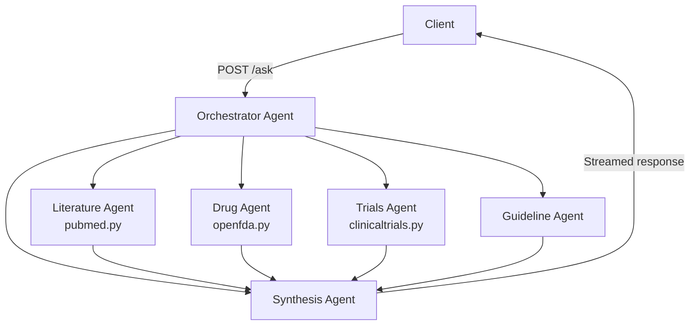
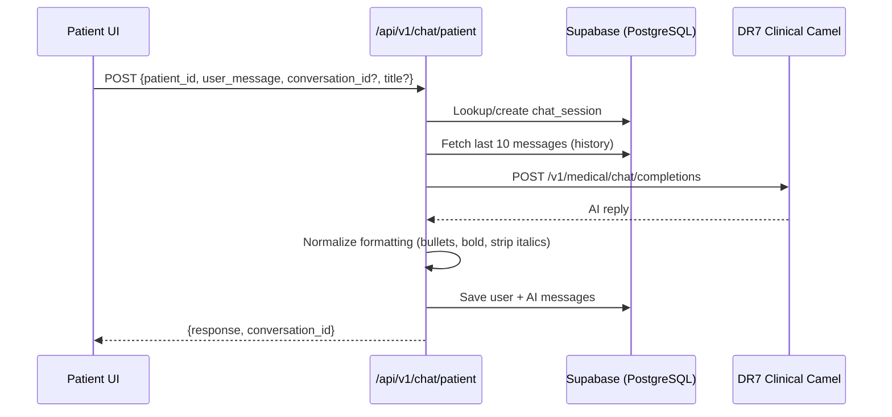
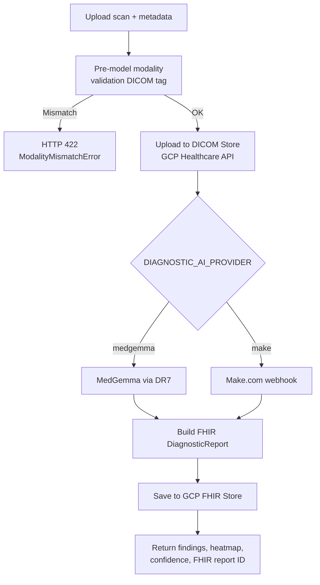
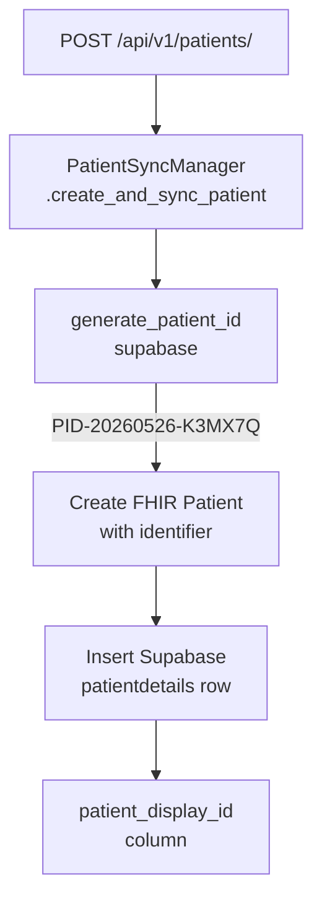

# Lyrah Healthcare Suite — Feature Documentation

> Auto-generated reference for the five core features: Research Tool, Patient Chatbot, Diagnostic Tool, Patient ID, and Session ID.

---

## Table of Contents

1. [Research Tool (MedAssist AI)](#1-research-tool-medassist-ai)
2. [Patient-Side Chatbot](#2-patient-side-chatbot)
3. [Diagnostic Tool](#3-diagnostic-tool)
4. [Patient ID](#4-patient-id)
5. [Session ID](#5-session-id)

---

## 1. Research Tool (MedAssist AI)

**Location:** `backend/research_assistant/`
**Main file:** `main.py` (FastAPI sub-app, mounted at `/research` in the parent EHR app)

### Overview

MedAssist AI is a research assistant for clinicians and doctors. It orchestrates queries across medical literature, drug databases, and clinical trials using a multi-agent architecture, returning evidence-level-tagged answers with real citations.

### Architecture — Orchestrator Agent Pattern



| Agent | File | Purpose |
|---|---|---|
| Orchestrator | `agents/orchestrator.py` | Routes queries to appropriate specialist agents |
| Literature | `agents/literature_agent.py` | PubMed search & summarisation |
| Drug | `agents/drug_agent.py` | openFDA drug lookups, adverse events, enforcement |
| Trials | `agents/trials_agent.py` | ClinicalTrials.gov search & details |
| Guideline | `agents/guideline_agent.py` | Medical guideline retrieval |
| Synthesis | `agents/synthesis_agent.py` | Merges all agent outputs into a single answer |

### External APIs

| API | Tool File | Description |
|---|---|---|
| PubMed (NCBI E-utilities) | `tools/pubmed.py` | Biomedical literature search |
| ClinicalTrials.gov | `tools/clinicaltrials.py` | Clinical trial search & detail retrieval |
| openFDA | `tools/openfda.py` | Drug info, adverse events, enforcement reports |

### Storage

SQLite database (`medpulse.db`) via SQLAlchemy.

| Model | Table | Key Columns |
|---|---|---|
| `ResearchSession` | `research_sessions` | `id`, `title`, `created_at`, `updated_at` |
| `ResearchMessage` | `research_messages` | `id`, `session_id`, `role`, `mode`, `content`, `query`, `evidence_level`, `citations_json`, `sources_json`, `filename`, `model_name` |
| `FeedItem` | `feed_items` | `id`, `category`, `specialty`, `impact_score`, `urgency`, `is_saved`, `published_at` |
| `UserProfile` | `user_profiles` | `id`, `name`, `specialties`, `institution` |

### API Endpoints

| Method | Path | Description |
|---|---|---|
| `GET` | `/research/` | Health check — name, version, status |
| `POST` | `/research/ask` | Submit query to orchestrator agent |
| `GET` | `/research/sessions` | List all research sessions |
| `POST` | `/research/sessions` | Create a new research session |
| `GET` | `/research/sessions/{id}` | Get session with full message history |
| `POST` | `/research/sessions/{id}/messages` | Append a message to a session |
| `PATCH` | `/research/sessions/{id}` | Rename a session |
| `DELETE` | `/research/sessions/{id}` | Delete session and all its messages |
| `DELETE` | `/research/sessions/{id}/messages/{mid}` | Delete a message and all subsequent messages |
| `GET` | `/research/feed` | Medical news feed (filterable by `category`, `specialty`, `limit`, `offset`) |
| `GET` | `/research/feed/ticker` | Critical/high urgency alerts (top 10) |
| `POST` | `/research/feed/save` | Bookmark / un-bookmark a feed item |

### Message Modes

Each research message has a `mode` field:

| Mode | Description |
|---|---|
| `ask` | Standard query via orchestrator |
| `image` | Image analysis query |
| `deep` | Deep-think / extended reasoning |
| `byod` | Bring-your-own-document analysis |

### Key Data Shapes

**AskRequest:**
```json
{
  "query": "What are the latest treatments for glioblastoma?",
  "specialty": "Oncology",
  "history": [{"role": "user", "content": "..."}, {"role": "assistant", "content": "..."}]
}
```

**ResearchMessage (stored):**
```json
{
  "session_id": 3,
  "role": "assistant",
  "mode": "ask",
  "content": "...",
  "query": "glioblastoma treatments",
  "evidence_level": "Level II",
  "citations_json": "[{\"type\":\"pubmed\",\"id\":\"38123456\"}]",
  "sources_json": "{\"follow_up_questions\": [...]}",
  "model_name": "gpt-4o"
}
```

### Scheduled Jobs

Configured via `scheduler.py` using APScheduler:

- Feed refresh (periodic)
- Seed data loaded at startup via `seed_data.py`

### Frontend

Components live in `frontend/src/components/research/` — includes `lyra/` (chat UI), `alerts/`, `newsfeed/`, `profile/`, and `layout/`.

---

## 2. Patient-Side Chatbot

**Location:** `backend/ehr/app/api/routes/chat.py`
**Frontend:** `frontend/src/components/patient/PatientChatSidebar.tsx` and `frontend/src/app/(patient)/patient-portal/ai-assistant/`

### Overview

A conversational health assistant embedded in the patient portal. Powered by the Clinical Camel model served via the DR7 API. Strictly scoped to basic health guidance — it refuses definitive diagnosis, prescription naming, specific dosing, and complex treatment recommendations.

### System Prompt Rules

The patient bot operates under these hard constraints:

1. **No definitive diagnosis** — uses hedged language: *"This may suggest…"*, *"Common causes include…"*
2. **Redirects complex cases** — responds: *"I can only assist with basic health guidance. For this, please consult your doctor."*
3. **Emergency detection** — for chest pain, difficulty breathing, severe bleeding, unconsciousness: *"This may be a medical emergency — call emergency services immediately."*
4. **No prescription drug names, doses, or interactions**
5. **Short, clear, plain-language responses** for patients
6. **Strict output format** — `**bold**` for section headings only, `•` (U+2022) for bullets, no markdown headings/italics/backticks

### Conversation Flow



### Storage (PostgreSQL via Supabase)

Tables are auto-created at module import via `psycopg2` DDL (idempotent):

**`chat_sessions`**

| Column | Type | Description |
|---|---|---|
| `id` | UUID (PK) | Auto-generated |
| `user_email` | TEXT | Patient email or synthetic `patient_id@lyrah.patient` |
| `title` | TEXT | Conversation title (defaults to first 60 chars of message) |
| `type` | TEXT | `"patient"` or `"doctor"` |
| `created_at` | TIMESTAMPTZ | Auto-set |

**`chat_messages`**

| Column | Type | Description |
|---|---|---|
| `id` | UUID (PK) | Auto-generated |
| `session_id` | UUID (FK → chat_sessions) | Parent session |
| `role` | TEXT | `"user"` or `"ai"` |
| `content` | TEXT | Message text |
| `created_at` | TIMESTAMPTZ | Auto-set |

Indexes: `idx_chat_sessions_user_type` on `(user_email, type)`, `idx_chat_messages_session` on `(session_id, created_at)`.

### API Endpoints

| Method | Path | Description |
|---|---|---|
| `POST` | `/api/v1/chat/patient` | Send a patient message; receive AI reply + session ID |
| `GET` | `/api/v1/chat/titles` | Get conversation sidebar titles for a patient |
| `GET` | `/api/v1/chat/messages/{conversation_id}` | Load full message history of a conversation |
| `POST` | `/api/v1/chat/doctor` | Doctor research chat (routes to Make.com webhook with optional file attachments) |

### Patient Chat Input

```json
{
  "patient_id": "uuid-from-supabase",
  "user_message": "I have a mild headache since morning.",
  "title": "Morning Headache",
  "conversation_id": null
}
```

### Patient Chat Output

```json
{
  "response": "**Common Causes:**\n• Tension headache\n• Dehydration\n\n**When to Seek Medical Advice:**\n• Headache persists beyond 48 hours\n• Accompanied by vision changes or stiff neck",
  "conversation_id": "550e8400-e29b-41d4-a716-446655440000"
}
```

### Frontend — PatientChatSidebar

Renders a sidebar with:
- **New Chat** button (blue, top)
- **History** list of past conversations (by title)
- Active chat highlighted with `bg-blue-50`
- Loading spinner while fetching

### Environment Variables

| Variable | Description |
|---|---|
| `DR7_BASE_URL` | Base URL for the DR7 AI API (default: `https://dr7.ai/api`) |
| `DR7_API_KEY` | API key for DR7 authentication |
| `DR7_CLINICAL_CAMEL_MODEL` | Model name (default: `clinical-camel`) |
| `DATABASE_URL` | PostgreSQL connection string for chat table DDL |

---

## 3. Diagnostic Tool

**Location:** `backend/diagtool/`
**Router:** `diagtool/app/api/router.py` (mounted at `/api/v1/diagtool/`)

### Overview

A medical imaging analysis pipeline that accepts scan uploads (JPEG, PNG, DICOM), validates modality consistency, runs AI analysis, stores results as a FHIR `DiagnosticReport`, and generates downloadable styled PDF reports.

### Supported Modalities

| Key | Display Name |
|---|---|
| `chest_xray` | Chest X-Ray |
| `ct_brain` | CT Brain |
| `echo` | Echocardiogram |
| `mri_spine` | MRI Spine |
| `usg_abdomen` | Ultrasound Abdomen |

### AI Providers

Selected via the `DIAGNOSTIC_AI_PROVIDER` environment variable:

| Provider | Value | Description |
|---|---|---|
| MedGemma | `"medgemma"` | MedGemma 27B via DR7 API — **default** |
| Make.com | `"make"` | Legacy webhook-based automation pipeline |

### Pipeline



### Key Services

| Service | File | Role |
|---|---|---|
| AI Provider | `services/ai_provider.py` | Dispatches to MedGemma or Make.com |
| MedGemma Client | `services/medgemma_client.py` | DR7 API integration for MedGemma 27B |
| Automation Service | `services/automation_service.py` | Make.com webhook trigger & wait |
| DICOM Service | `services/dicom_service.py` | Convert & upload to GCP DICOM store |
| FHIR Service | `services/fhir_service.py` | Create/read FHIR DiagnosticReport resources |
| Report Service | `services/report_service.py` | Retrieve and inspect existing reports |

### Data Models (`models/diagnostic.py`)

| Model | Purpose |
|---|---|
| `InitiateAnalysisData` | Input metadata: `patientId`, `nameOfScan`, `medicalHistoryOrReasonOfScan`, `ageOfPatient` |
| `LlmAnalysisResult` | AI output: `modality`, `findings[]`, `impression`, `severity`, `likely_diagnosis`, `confidence_level`, `classification_scores[]`, `heatmap_image`, `heatmap_raw`, `enriched_reasoning`, `modality_warning` |
| `ModalityMismatchError` | Raised when uploaded image doesn't match declared modality |
| `ClassificationScore` | `{label: str, score: float}` for individual classification labels |

### API Endpoints

#### `POST /api/v1/diagtool/analyze`

**Input** (multipart/form-data):

| Field | Type | Required | Description |
|---|---|---|---|
| `patientId` | string | Yes | Patient FHIR ID |
| `nameOfScan` | string | Yes | Scan modality key (e.g. `chest_xray`) |
| `medicalHistoryOrReasonOfScan` | string | Yes | Clinical context |
| `ageOfPatient` | string | Yes | Patient age |
| `scanOrReport` | file(s) | Yes | Uploaded scan images |

**Output:**

```json
{
  "status": "success",
  "message": "Report created",
  "fhirReportId": "dr-uuid-here",
  "ai_status": "final",
  "ai_error": null,
  "analysis": {
    "modality": "chest_xray",
    "findings": ["No acute cardiopulmonary abnormality"],
    "impression": "Normal chest radiograph",
    "severity": "Low",
    "likely_diagnosis": "Normal",
    "confidence_level": "High",
    "limitations": null,
    "classification_scores": [{"label": "Normal", "score": 0.92}],
    "heatmap_image": "base64...",
    "heatmap_raw": "base64...",
    "enriched_reasoning": "...",
    "modality_warning": null
  }
}
```

**Error cases:**

| HTTP Code | Condition | Response |
|---|---|---|
| 422 | Modality mismatch | `{error: "modality_mismatch", declared_modality, detected_modality, confidence, message}` |
| 422 | Invalid image | `{error: "invalid_image", message}` |
| 500 | DICOM upload failure | "Failed to store medical images." |
| 500 | FHIR save failure | "Failed to save report to database." |
| 503 | AI service unavailable | "AI Service Unavailable" |

On AI failure, the tool creates a FHIR report with `status: "preliminary"` and appends `[AI FAILED]` to the conclusion — ensuring the scan is still tracked even when AI is down.

#### `POST /api/v1/diagtool/report/pdf`

Generates a styled PDF diagnostic report matching the in-app UI. Accepts `PdfReportRequest` JSON body with all analysis fields plus optional `heatmap_image`, `original_image`, `heatmap_opacity`, and `modality_warning`.

### Environment Variables

| Variable | Description |
|---|---|
| `DIAGNOSTIC_AI_PROVIDER` | `"medgemma"` or `"make"` |
| `DR7_API_KEY` | API key for DR7 / MedGemma |
| `GCP_CREDENTIALS_PATH` | Path to GCP service account JSON |
| `GCP_PROJECT_ID` | Google Cloud project |
| `GCP_FHIR_STORE` | FHIR store path |
| `GCP_DICOM_STORE` | DICOM store path |

---

## 4. Patient ID

**Location:** `backend/ehr/app/utils/id_generator.py`

### Format

```
PID-YYYYMMDD-XXXXXX
```

- `YYYYMMDD` — Current date
- `XXXXXX` — 6-character cryptographically random token from `[A-Z0-9]`

**Example:** `PID-20260526-K3MX7Q`

### Function Signature

```python
def generate_patient_id(supabase: Client, max_attempts: int = 10) -> str
```

### Uniqueness Guarantee

Before returning a candidate ID, the function queries the `patientdetails` table in Supabase:

```python
res = supabase.table("patientdetails")
    .select("patient_display_id")
    .eq("patient_display_id", candidate)
    .limit(1).execute()
```

If the ID already exists (collision), it retries with a new token up to `max_attempts` times. The probability of collision is negligible: **6 chars from 36 symbols = 36^6 ≈ 2.18 billion combinations per day**.

### Integration Flow



1. Called inside `PatientSyncManager.create_and_sync_patient()` in `reg_and_sched/app/patient_sync_service.py`
2. Stored as `patient_display_id` in the `patientdetails` Supabase table
3. Also embedded in the FHIR Patient `identifier` array with system URI `https://lyrah.health/pid`:
   ```json
   "identifier": [{"system": "https://lyrah.health/pid", "value": "PID-20260526-K3MX7Q"}]
   ```
4. The `patient_display_id` column is auto-created at first run via psycopg2 DDL (idempotent) with a unique index

### Where Used

| Endpoint | Trigger |
|---|---|
| `POST /api/v1/patients/` | New patient registration |
| `PatientSyncManager.create_and_sync_patient()` | Unified FHIR + Supabase patient creation |

---

## 5. Session ID

**Location:** `backend/ehr/app/utils/id_generator.py`

### Format

```
SID-YYYYMMDD-XXXXXX
```

- `YYYYMMDD` — Current date
- `XXXXXX` — 6-character cryptographically random token from `[A-Z0-9]`

**Example:** `SID-20260526-A9LT2P`

### Function Signature

```python
def generate_session_id(supabase: Client, max_attempts: int = 10) -> str
```

### Uniqueness Guarantee

Same collision-avoidance pattern as Patient ID. Checks the `appointments` table:

```python
res = supabase.table("appointments")
    .select("session_display_id")
    .eq("session_display_id", candidate)
    .limit(1).execute()
```

Retries up to `max_attempts` on collision. Same probability analysis: ~2.18 billion combinations per day.

### Integration Flow

1. Generated and assigned when a new appointment is created
2. Stored as `session_display_id` in the `appointments` Supabase table
3. Column auto-created at first run via psycopg2 DDL (idempotent) with a unique index:
   ```sql
   ALTER TABLE appointments ADD COLUMN IF NOT EXISTS session_display_id TEXT UNIQUE;
   CREATE INDEX IF NOT EXISTS idx_session_display_id ON appointments(session_display_id);
   ```

### Design Rationale

Both Patient ID and Session ID share the same format pattern (`PREFIX-DATE-TOKEN`) because:

- **Human-readable** — clinicians can immediately see when a patient was registered or an appointment was created
- **Collision-safe** — cryptographic randomness (`secrets.choice`) ensures no predictable sequences
- **Globally unique** — combination of date + 6-char token + uniqueness check makes duplicates virtually impossible
- **Consistent** — uniform format across all display IDs in the system

---

## Appendix — Quick Reference: All Environment Variables

| Variable | Feature | Description |
|---|---|---|
| `DR7_BASE_URL` | Chatbot, Diagnostic | Base URL for DR7 AI API |
| `DR7_API_KEY` | Chatbot, Diagnostic | API key for DR7 authentication |
| `DR7_CLINICAL_CAMEL_MODEL` | Chatbot | Clinical Camel model name |
| `DIAGNOSTIC_AI_PROVIDER` | Diagnostic | `"medgemma"` or `"make"` |
| `DATABASE_URL` | Chatbot, IDs | PostgreSQL connection string for DDL |
| `GCP_PROJECT_ID` | Diagnostic | Google Cloud project |
| `GCP_FHIR_STORE` | Diagnostic | FHIR store path |
| `GCP_DICOM_STORE` | Diagnostic | DICOM store path |
| `DOCTOR_RESEARCH_WEBHOOK_URL` | Chatbot (Doctor) | Make.com webhook for doctor research |
| `SUPABASE_URL` | All features | Supabase project URL |
| `SUPABASE_KEY` | All features | Supabase anon/service key |

---

*Last updated: 2026-05-26*
