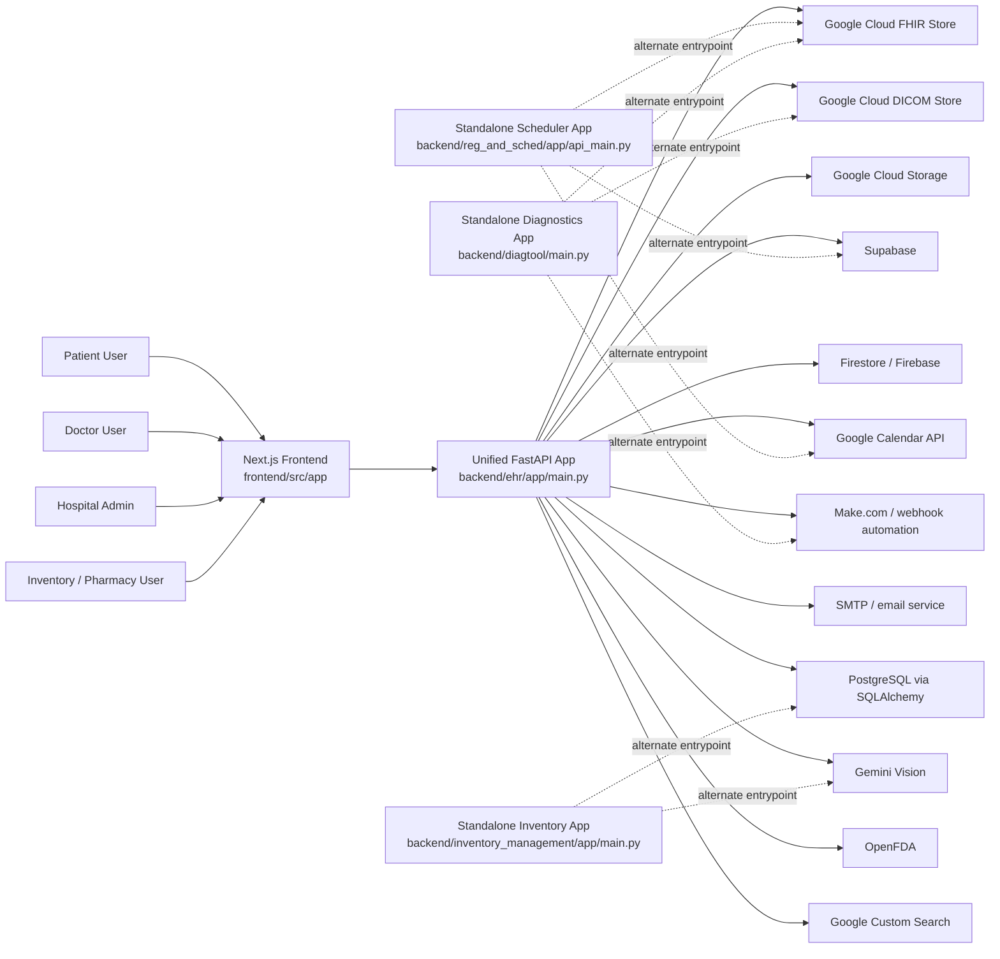
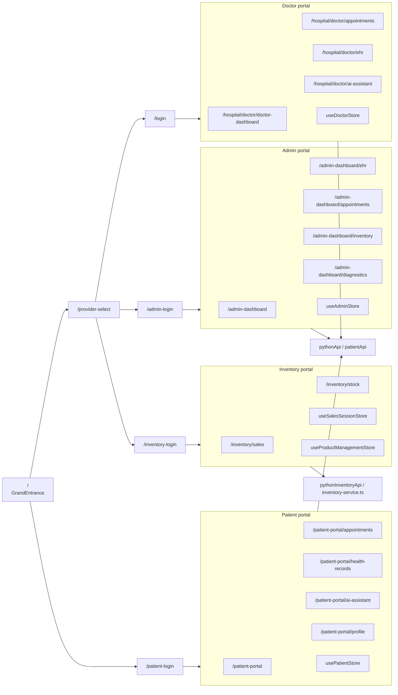
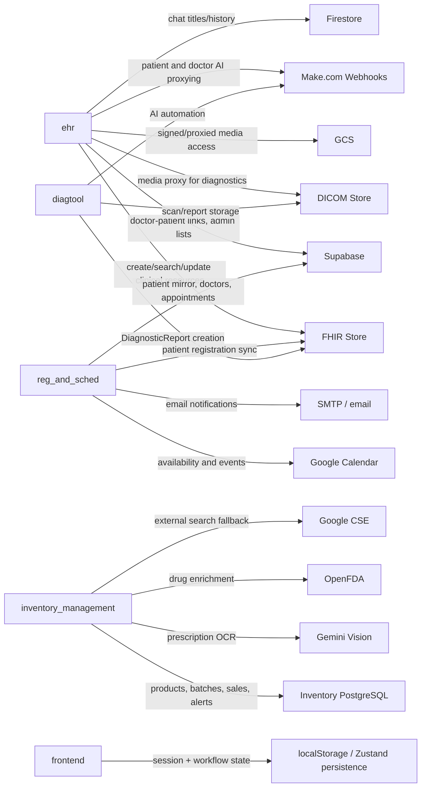
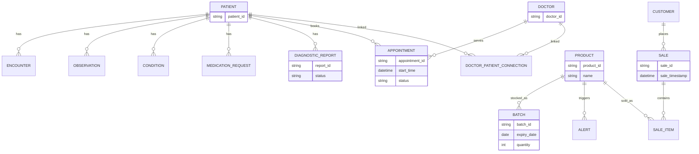
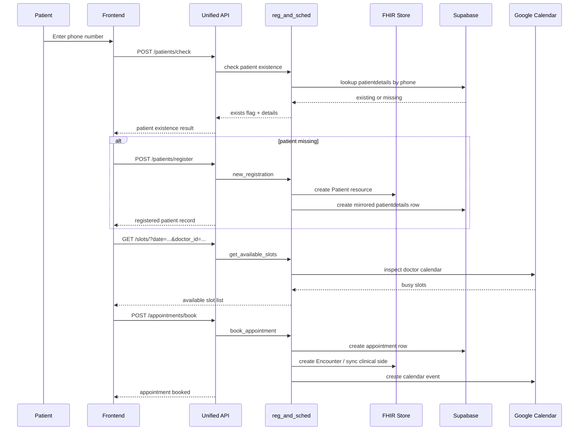
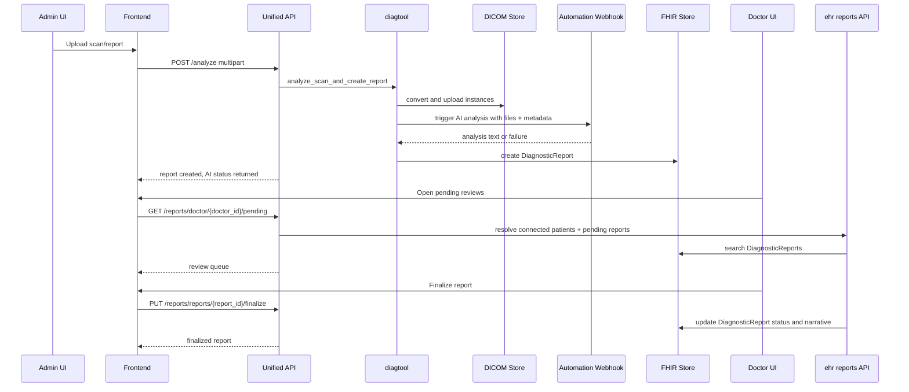
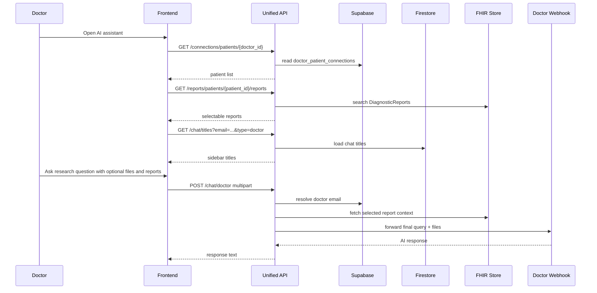
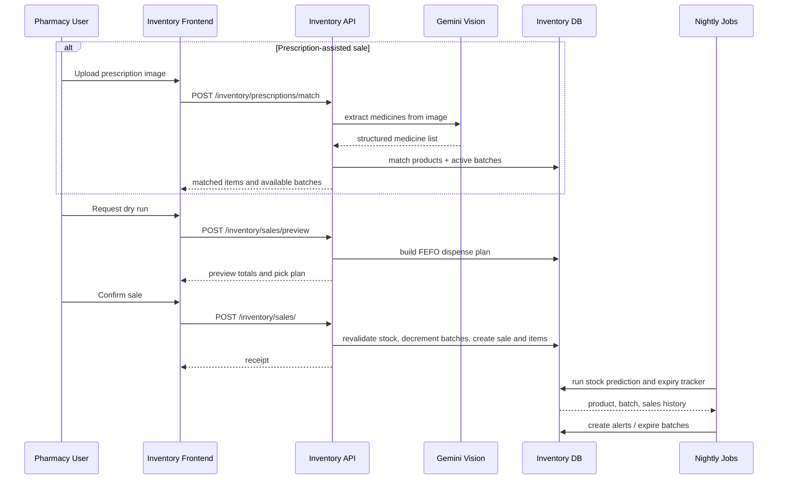

# Healthcare Suite Discovery Guide

Created as a new standalone discovery/onboarding document so the existing KT files can stay untouched.

Reviewed against live repo structure and code on 2026-04-14.

## 1. What This Repository Actually Is

Healthcare Suite is a multi-portal healthcare platform in a single repository.

At runtime, it behaves like one product with:

- a Next.js frontend for patient, doctor, admin, and inventory users
- a unified FastAPI backend that mounts multiple domain routers into one API shell
- several domain modules that still retain their own standalone entrypoints

The repo is organized around four backend domains:

- `backend/ehr`: core clinical API layer and the unified FastAPI shell
- `backend/reg_and_sched`: patient registration, doctor registry, scheduling, appointments
- `backend/diagtool`: diagnostic upload, DICOM handling, AI analysis orchestration, report creation
- `backend/inventory_management`: pharmacy inventory, sales, alerts, enrichment, analytics

The frontend lives in `frontend/` and is built as a single Next.js app with distinct route groups for each user experience.

## 2. The Runtime Truth

For normal full-stack work, the main runtime is:

- backend: `backend/ehr/app/main.py`
- frontend: `frontend/src/app`

That unified backend mounts:

- EHR routes under `/api/v1/...`
- doctor routes under `/api/v1/doctors/...`
- scheduler routes under `/api/v1/...`
- diagnostics intake under `/api/v1/analyze`
- inventory routes under `/api/v1/inventory/...`
- admin routes under `/api/v1/admin/...`

Standalone apps still exist and matter for understanding the architecture:

- `backend/reg_and_sched/app/api_main.py`
- `backend/diagtool/main.py`
- `backend/inventory_management/app/main.py`

Those are not the default full-platform runtime, but they still reveal ownership boundaries and a few route differences.

## 3. Quick Repo Map

| Area | Path | Role in the platform | Normal runtime role |
| --- | --- | --- | --- |
| Root orientation | `README.md` | local run guide | points to unified runtime |
| Existing KT docs | `TECHNICAL_KT.md`, `TECHNICAL_KT_APPENDIX.md` | prior handoff/reference docs | supplemental only |
| Unified backend shell | `backend/ehr/app/main.py` | composes all backend domains | primary backend entrypoint |
| Core clinical module | `backend/ehr/app` | FHIR-facing clinical APIs, reports, chat, admin, media | always active in unified runtime |
| Registration + scheduling | `backend/reg_and_sched/app` | patient registration, doctor management, appointments | mounted into unified runtime |
| Diagnostics module | `backend/diagtool/app` | scan upload, DICOM, AI analysis, DiagnosticReport creation | mounted into unified runtime |
| Inventory module | `backend/inventory_management/app` | products, batches, sales, alerts, analytics | mounted into unified runtime |
| Frontend | `frontend/src/app` | doctor, patient, admin, inventory portals | primary web UI |
| Frontend clients + state | `frontend/src/lib`, `frontend/src/store`, `frontend/src/context` | API clients, session stores, workflow state | shared by route groups |

## 4. System Context Diagram

## 5. Backend Composition Diagram

```mermaid
flowchart TD
    Main["backend/ehr/app/main.py\nUnified FastAPI app"]

    subgraph EHR["ehr domain"]
        Patients["/api/v1/patients"]
        Encounters["/api/v1/encounters"]
        Observations["/api/v1/observations"]
        Conditions["/api/v1/conditions"]
        Meds["/api/v1/medication-requests"]
        Terminology["/api/v1/terminology"]
        Summary["/api/v1/summary"]
        Reports["/api/v1/reports"]
        Chat["/api/v1/chat"]
        Connections["/api/v1/connections"]
        Media["/api/v1/media/{token}"]
        Admin["/api/v1/admin"]
    end

    subgraph Scheduling["reg_and_sched domain"]
        Doctors["/api/v1/doctors"]
        Scheduler["/api/v1/patients/check\n/api/v1/patients/register\n/api/v1/slots\n/api/v1/appointments/*"]
    end

    subgraph Diagnostics["diagtool domain"]
        Analyze["/api/v1/analyze"]
    end

    subgraph Inventory["inventory_management domain"]
        InventoryAPI["/api/v1/inventory/*"]
        Jobs["/api/v1/inventory/jobs/trigger-stock-prediction"]
    end

    Main --> Reports
    Main --> Patients
    Main --> Encounters
    Main --> Observations
    Main --> Conditions
    Main --> Meds
    Main --> Terminology
    Main --> Summary
    Main --> Chat
    Main --> Connections
    Main --> Media
    Main --> Doctors
    Main --> Scheduler
    Main --> InventoryAPI
    Main --> Jobs
    Main --> Admin
    Main --> Analyze
```

## 6. Frontend Portal Map

## 7. Data Ownership and Integration Map

## 8. Domain Relationship Diagram

## 9. Module Deep Dive: Frontend Shell and Portals

### Purpose

The frontend is the operator-facing and patient-facing shell for the whole platform. It is a single Next.js application with multiple route groups, shared API clients, and small persisted Zustand stores for identity and workflow state.

### Core entrypoints

- `frontend/src/app/layout.tsx`: global app shell
- `frontend/src/app/page.tsx`: root landing page
- `frontend/src/app/provider-select/page.tsx`: staff portal branching page
- route groups in `frontend/src/app/(dashboard)`, `(patient)`, `(admin)`, `(auth)`, and `inventory`

### Shared client and state layer

| File | Responsibility |
| --- | --- |
| `frontend/src/lib/python-api.ts` | main Axios clients for `/api/v1`, multipart, and `/api/v1/inventory` |
| `frontend/src/lib/patient-api.ts` | simplified patient-oriented Axios client |
| `frontend/src/lib/inventory-service.ts` | typed inventory API wrappers |
| `frontend/src/store/patientStore.ts` | persisted patient session |
| `frontend/src/store/doctorStore.ts` | persisted doctor session |
| `frontend/src/store/adminStore.ts` | persisted admin session |
| `frontend/src/store/sales-session.store.ts` | inventory sale-session/cart workflow |
| `frontend/src/store/product-management.store.ts` | inventory dialog state |
| `frontend/src/context/research-context.tsx` | doctor AI assistant research state |

### Doctor portal feature detail

Primary routes:

- `/hospital/doctor/doctor-dashboard`
- `/hospital/doctor/appointments`
- `/hospital/doctor/ehr`
- `/hospital/doctor/ai-assistant`

What the portal does:

- shows daily schedule and upcoming appointments from `/appointments/doctor/{doctor_id}`
- lets doctors approve or cancel appointment requests via `/appointments/{appointment_id}/status`
- surfaces pending diagnostic reviews from `/reports/doctor/{doctor_id}/pending`
- lists connected patients via `/connections/patients/{doctor_id}`
- opens full patient records by combining `/patients`, `/conditions`, `/medication-requests`, `/observations`, and `/reports`
- runs the doctor research assistant through multipart requests to `/chat/doctor`

Key implementation patterns:

- `useDoctorStore` persists doctor ID, name, email, specialization, and designation
- doctor EHR page loads multiple clinical resources in parallel when a patient is opened
- doctor AI assistant can attach selected report IDs and uploaded files to enrich the webhook request

### Patient portal feature detail

Primary routes:

- `/patient-portal`
- `/patient-portal/appointments`
- `/patient-portal/health-records`
- `/patient-portal/ai-assistant`
- `/patient-portal/profile`

What the portal does:

- shows upcoming appointments and recent finalized reports
- books appointments by combining `/doctors/search`, `/slots`, and `/appointments/book`
- reads health records through `/patients/{patient_id}`, `/conditions`, `/medication-requests`, `/observations`, and `/reports/patients/{patient_id}/reports`
- opens individual report detail via `/reports/reports/{report_id}`
- supports patient AI chat via `/chat/patient` plus Firestore-backed title/history routes

Key implementation patterns:

- `usePatientStore` persists patient session in localStorage
- appointment booking is a stepwise UI: choose doctor, choose date, load slots, review, then book
- dashboard and health-record pages both derive vital cards from FHIR Observation bundles

### Admin portal feature detail

Primary routes:

- `/admin-dashboard`
- `/admin-dashboard/ehr`
- `/admin-dashboard/appointments`
- `/admin-dashboard/inventory`
- `/admin-dashboard/diagnostics`

What the portal does:

- shows top-level hospital metrics through `/admin/stats`
- loads global schedule via `/admin/appointments/all`
- loads user registries via `/admin/users/all`
- loads diagnostic report history via `/admin/reports/all`
- uploads diagnostics through `/analyze`

Diagnostics page behavior:

- patient search is powered by `/admin/users/all?type=patient`
- recent report history is driven by `/admin/reports/all?limit=50`
- scan upload posts multipart form data to `/analyze`

### Inventory portal feature detail

Primary routes:

- `/inventory/sales`
- `/inventory/stock`

What the portal does:

- creates manual sale sessions or prescription-driven sale sessions
- uploads prescriptions to `/inventory/prescriptions/match`
- previews a FEFO dispense plan with `/inventory/sales/preview`
- commits transactional sales with `/inventory/sales/`
- manages products, batches, suppliers, alerts, analytics, and job triggers

Key implementation patterns:

- `useSalesSessionStore` models multiple active sale sessions, each with its own cart
- `inventory-service.ts` is the main typed adapter for inventory APIs
- stock page merges product management, analytics, and sales history into one operator workspace

### Frontend caveats

- `frontend/src/app/(patient)/patient-portal/login/page.tsx` is a separate localStorage-style flow that is not the same as the main `/patient-login` journey
- `frontend/src/store/useChatStore.ts` is currently an empty file
- `frontend/src/hooks/usePatientData.ts` is currently an empty file
- `frontend/src/app/api/v1/registration/new/route.ts`, `frontend/src/app/api/v1/patients/[patientId]/route.ts`, and `frontend/src/app/api/v1/summary/patient/[patientId]/route.ts` are present but currently empty

## 10. Module Deep Dive: `backend/ehr`

### Purpose

`backend/ehr` is both:

- the platform's core clinical module
- the composition shell that turns the repo into one unified backend

It owns the clinical APIs that work directly with FHIR resources and also hosts cross-cutting capabilities like reports, media proxying, chat, connections, and admin dashboards.

### Primary entrypoints

- unified shell: `backend/ehr/app/main.py`
- dependencies: `backend/ehr/app/api/deps.py`
- configuration: `backend/ehr/app/core/config.py`

### Main API surfaces

| Surface | Route family | What it does |
| --- | --- | --- |
| Patients | `/api/v1/patients` | create, get, search patient resources |
| Encounters | `/api/v1/encounters` | encounter CRUD, doctor notes |
| Observations | `/api/v1/observations` | quick vital creation and search |
| Conditions | `/api/v1/conditions` | create/search conditions |
| Medication Requests | `/api/v1/medication-requests` | create/search active medications |
| Terminology | `/api/v1/terminology` | vitals, LOINC, encounter-class, ICD-10 lookup helpers |
| Summary | `/api/v1/summary` | patient-summary aggregation |
| Reports | `/api/v1/reports` | list detail finalize pending-review flows |
| Chat | `/api/v1/chat` | titles, history, patient proxy, doctor proxy |
| Connections | `/api/v1/connections` | doctor-patient relationship workflows |
| Media | `/api/v1/media/{token:path}` | tokenized diagnostic media access |
| Admin | `/api/v1/admin` | global stats, users, reports, appointments |

### Core services and responsibilities

| File | Responsibility |
| --- | --- |
| `app/services/fhir_service.py` | async wrapper around Google Cloud Healthcare FHIR APIs |
| `app/services/gcp_clients.py` | credential loading |
| `app/services/gcs_service.py` | signed URL generation |
| `app/services/supabase_service.py` | shared Supabase client |
| `app/services/report_service.py` | report list/detail shaping for frontend views |

### Feature detail

Clinical resource APIs:

- patient resources are stored and searched in the FHIR store
- observation flows support "easy vital" creation and broader observation search
- medication requests and conditions follow the same FHIR-centered pattern
- terminology endpoints exist so the UI does not need to hardcode coding systems

Report lifecycle support:

- doctors fetch patient reports via `/reports/patients/{patient_id}/reports`
- single report detail is shaped for richer frontend display
- finalization rewrites the `DiagnosticReport` conclusion and HTML narrative
- pending review lists are resolved through a combination of Supabase doctor-patient links and FHIR search

AI/chat support:

- conversation titles and message history are pulled from Firestore
- patient chat is proxied to a patient webhook
- doctor chat is proxied as multipart form data and can include selected report context and attachments

Admin support:

- patient, doctor, and schedule lists are operational views built on Supabase and FHIR
- recent report list is fetched directly from `DiagnosticReport` search

### External integrations

- Google Cloud FHIR store
- Google Cloud DICOM store through report/media access paths
- Google Cloud Storage
- Firestore / Firebase
- Supabase
- Make.com webhooks for AI/chat
- GCP credentials loaded via `.env` or environment variables

### Data ownership

- source of truth for clinical records is the FHIR store
- source of truth for chat history is Firestore
- operational relationship tables such as `doctor_patient_connections` are in Supabase
- media delivery is proxied through EHR routes even when the original storage came from diagnostics infrastructure

### Known caveats

- `backend/ehr/app/api/routes/documents.py` exists but is not active in the unified runtime
- the unified app imports `documents` but does not mount a documents router
- `backend/ehr/app/main.py` also starts inventory scheduler jobs, so it is more than a pure clinical app shell
- the admin inventory metric in `admin.py` reads a Supabase `products` table if present; it is not using the inventory module's SQLAlchemy database session

## 11. Module Deep Dive: `backend/reg_and_sched`

### Purpose

`backend/reg_and_sched` owns the operational workflow around:

- finding or registering patients
- managing doctors
- calculating availability
- booking and updating appointments
- syncing operational and clinical records

### Entrypoints

- mounted router path in unified runtime: `backend/reg_and_sched/app/api/scheduler_routes.py`
- doctor router: `backend/reg_and_sched/app/api/doctors.py`
- standalone app: `backend/reg_and_sched/app/api_main.py`

### Main route surfaces

| Route | Role |
| --- | --- |
| `POST /api/v1/patients/check` | find existing patient by phone |
| `POST /api/v1/patients/register` | create patient record and sync |
| `GET /api/v1/slots/` | get doctor-specific available slots |
| `POST /api/v1/appointments/book` | book appointment |
| `GET /api/v1/appointments/doctor/{doctor_id}` | doctor schedule |
| `PATCH /api/v1/appointments/{appointment_id}/status` | confirm/cancel/complete appointment |
| `GET /api/v1/appointments/patient/{patient_id}` | patient upcoming appointments |
| `POST /api/v1/doctors/login` | doctor login |
| `POST /api/v1/doctors/` | doctor creation |
| `GET /api/v1/doctors/search` | doctor lookup for booking UIs |
| `GET /api/v1/doctors/{doctor_id}/auth/url` | start Google Calendar OAuth |
| `GET /api/v1/doctors/auth/callback` | OAuth callback |
| `DELETE /api/v1/doctors/{doctor_id}/auth` | disconnect Google Calendar |
| `POST /api/v1/doctors/monitor-connections` | refresh/check doctor calendar links |

### Main service layer

| File | Responsibility |
| --- | --- |
| `app/registration.py` | patient registration orchestration |
| `app/scheduling.py` | slot calculation, booking, cancellation logic |
| `app/services.py` | Supabase DB service, calendar service, notification service |
| `app/patient_sync_service.py` | keeps FHIR and operational patient records aligned |
| `app/doctor_manager.py` | Google OAuth and doctor-calendar management |

### Feature detail

Patient registration:

- user flow begins with phone-number existence check
- if missing, registration creates the patient and mirrors it into both clinical and operational stores
- the frontend expects the Supabase-shaped response back from registration

Scheduling:

- slot lookup is doctor-specific
- booking combines patient ID, doctor ID, chosen slot, and reason
- doctor and patient views both consume the same appointment table from different perspectives
- status updates are lightweight operational mutations used by doctor and admin UIs

Doctor operations:

- admin users can create doctors
- doctor records include department, designation, specialization, email, and phone
- Google Calendar OAuth is used so availability and appointment event creation can operate against a real calendar
- a monitor endpoint can refresh existing connections and trigger reconnect emails if necessary

### External integrations

- Supabase operational tables
- Google Cloud FHIR store
- Google Calendar OAuth + Calendar API
- SMTP/email notification service

### Data ownership

- appointments, doctors, and patient mirror tables live in Supabase
- canonical clinical patient data also exists in FHIR
- availability is derived from calendar state plus scheduling rules

### Known caveats

- the standalone app exposes `DELETE /appointments/{appointment_id}` for cancellation, but that route is not mounted in the unified router set
- in practice this means unified full-stack runtime supports booking and status changes, but not the standalone cancellation endpoint
- the unified scheduler routes are defined separately from `api_main.py`, so the two entrypoints are similar but not identical

## 12. Module Deep Dive: `backend/diagtool`

### Purpose

`backend/diagtool` is the diagnostics intake and AI orchestration module. It turns uploaded scans or reports into persisted diagnostic artifacts that doctors can later review and finalize.

### Entrypoints

- mounted route in unified runtime: `POST /api/v1/analyze`
- standalone app: `backend/diagtool/main.py`
- standalone health route: `GET /health`

### Core implementation files

| File | Responsibility |
| --- | --- |
| `app/api/router.py` | main upload/analyze/create-report endpoint |
| `app/services/dicom_service.py` | convert uploads and store them as DICOM instances |
| `app/services/automation_service.py` | trigger and wait for AI analysis |
| `app/utils/parser.py` | parse AI text into structured model |
| `app/utils/fhir_mapper.py` | convert AI result + intake metadata into `DiagnosticReport` |
| `app/models/diagnostic.py` | intake and AI result models |

### Feature detail

Scan/report intake:

- accepts multipart uploads with patient ID, scan name, reason/history, age, and one or more files
- generates study and series UIDs
- rewinds uploaded files so they can be reused for both DICOM upload and automation webhook calls

AI analysis orchestration:

- packages metadata and uploaded files for the automation layer
- waits for returned analysis text
- parses that text into a structured diagnostic result model

FHIR persistence:

- maps intake metadata and AI result to a `DiagnosticReport`
- stores DICOM paths in the report context
- if AI fails, still creates a report with placeholder analysis, marks it as partial/preliminary, and returns the failure metadata to the caller

Doctor follow-through:

- the actual doctor review and final sign-off happens in `backend/ehr/app/api/routes/reports.py`
- diagnostics creation and doctor finalization are intentionally split across two modules

### External integrations

- Google Cloud DICOM store
- Google Cloud FHIR store
- automation webhook layer

### Data ownership

- diagnostic media lives in DICOM storage
- report structure and lifecycle state live in FHIR `DiagnosticReport`
- frontend access later flows through EHR report and media APIs

### Known caveats

- `app/api/router.py` constructs a global `fhir_service` at import time and returns `503` if unavailable
- the admin diagnostics frontend currently hardcodes `ageOfPatient` to `"30"` during upload
- AI failure does not stop persistence; it creates a reviewable partial report instead

## 13. Module Deep Dive: `backend/inventory_management`

### Purpose

`backend/inventory_management` is the pharmacy and stock-control backend. It owns product master data, batches, FEFO sales planning, transaction commits, alerts, analytics, and enrichment/OCR helpers.

### Entrypoints

- mounted router in unified runtime: `/api/v1/inventory/*`
- standalone app: `backend/inventory_management/app/main.py`
- mount adapter: `backend/inventory_management/inventory_router.py`

### Main route surfaces

| Route family | Responsibility |
| --- | --- |
| `/inventory/auth/*` | pharmacist and admin login |
| `/inventory/products/*` | create/search/get products, get batches, enrich product info |
| `/inventory/batches/*` | create and retrieve batches |
| `/inventory/sales/preview` | dry-run FEFO dispense plan |
| `/inventory/sales/` | commit transactional sale |
| `/inventory/sales/` `GET` | paginated sales history |
| `/inventory/analytics/*` | KPI summaries, top sellers, slow movers, sales trends |
| `/inventory/prescriptions/match` | OCR prescription image and match to inventory |
| `/inventory/suppliers/*` | supplier search/create |
| `/inventory/alerts/*` | unread alerts and mark-as-read |
| `/inventory/jobs/trigger-stock-prediction` | manual inventory job trigger |

### Internal structure

| Layer | Key files |
| --- | --- |
| API | `app/api/v1/endpoints/*` |
| CRUD | `app/crud/*` |
| Models | `app/models/models.py` |
| Schemas | `app/schemas/*` |
| DB | `app/db/session.py`, `app/db/base.py` |
| Services | `app/services/sale_service.py`, `ai_service.py`, `enrichment_service.py` |
| Jobs | `app/jobs/stock_predictor.py`, `app/jobs/expiry_tracker.py` |

### Feature detail

Product and batch management:

- products represent the stock master record
- batches carry expiry, quantity, pricing, and physical shelf/rack location
- enrichment can augment product metadata from external sources

Prescription-assisted selling:

- uploaded prescription image is validated for type and size
- Gemini Vision extracts medicines and quantities
- fuzzy matching aligns extracted medicines with local products
- available batches are returned in FEFO order with location hints

Sales workflow:

- preview step calculates a dispense plan without changing stock
- commit step revalidates stock and runs as a transaction
- receipt response is shaped after eager-loading related sale items and products

Analytics and alerts:

- summary endpoint returns KPIs
- top-sellers, slow-movers, and trend endpoints power charts and performance views
- nightly jobs create `OUT_OF_STOCK`, `BELOW_THRESHOLD`, `LOW_STOCK`, `NEAR_EXPIRY`, and `EXPIRED_STOCK` alerts

Enrichment support:

- local cache lookup comes first
- OpenFDA is used as structured tier-two lookup
- Google CSE plus scraping acts as a fallback enrichment tier

### External integrations

- PostgreSQL via SQLAlchemy
- Gemini Vision for prescription extraction
- OpenFDA
- Google Custom Search and scraping fallback

### Data ownership

- product, batch, sale, sale item, customer, supplier, and alert data live in the inventory database
- this module is the only backend domain in the repo clearly built around SQLAlchemy/Postgres as primary persistence

### Known caveats

- the standalone app exposes `/api/v1/jobs/trigger-stock-prediction`, while the unified shell remounts the manual trigger at `/api/v1/inventory/jobs/trigger-stock-prediction`
- the inventory portal is tightly aligned with typed frontend wrappers in `frontend/src/lib/inventory-service.ts`; that file is the best companion when tracing UI-to-API behavior

## 14. End-to-End Flow: Patient Registration and Appointment Booking

### What matters here

- this flow crosses both operational and clinical stores
- the booking UI is doctor-aware, not generic
- calendar connectivity is part of the booking architecture, not an optional add-on

## 15. End-to-End Flow: Diagnostics Upload to Doctor Review

### What matters here

- diagnostics creation is not the same thing as doctor sign-off
- AI failure is degraded, not terminal
- media storage and report storage are split across DICOM and FHIR

## 16. End-to-End Flow: Doctor AI Assistant

### What matters here

- this is not a generic chatbot; it is context-aware around patient connections and reports
- Firestore stores history, while the reasoning/proxy step goes through a webhook
- report IDs can materially change the final prompt sent downstream

## 17. End-to-End Flow: Inventory Sale and Alert Jobs

### What matters here

- preview and commit are intentionally separate
- stock allocation is FEFO-based
- jobs are part of the product experience because alerts feed operator workflows

## 18. Feature-to-Implementation Matrix

| Feature | Frontend surface | Backend endpoints | Owning module(s) | Source of truth / integration |
| --- | --- | --- | --- | --- |
| Patient discovery and registration | `/patient-login`, `/patient-register` | `/patients/check`, `/patients/register` | `reg_and_sched` | Supabase + FHIR |
| Doctor lookup for booking | `/patient-portal/appointments` | `/doctors/search` | `reg_and_sched` | Supabase doctors table |
| Slot discovery | `/patient-portal/appointments` | `/slots/` | `reg_and_sched` | Google Calendar + scheduling rules |
| Appointment booking | `/patient-portal/appointments` | `/appointments/book` | `reg_and_sched` | Supabase + Calendar + FHIR |
| Doctor schedule management | `/hospital/doctor/doctor-dashboard` | `/appointments/doctor/{doctor_id}`, `/appointments/{id}/status` | `reg_and_sched` | Supabase appointments |
| Doctor-patient relationship management | doctor EHR and research flows | `/connections/*` | `ehr` | Supabase `doctor_patient_connections` + FHIR reads |
| Patient clinical record view | `/hospital/doctor/ehr`, `/patient-portal/health-records` | `/patients`, `/conditions`, `/medication-requests`, `/observations`, `/reports` | `ehr` | FHIR |
| Diagnostic upload | `/admin-dashboard/diagnostics` | `/analyze` | `diagtool` | DICOM + FHIR + webhook |
| Diagnostic review/finalization | `/hospital/doctor/doctor-dashboard`, doctor review modal | `/reports/doctor/{doctor_id}/pending`, `/reports/reports/{report_id}/finalize` | `ehr` + `diagtool` | FHIR + Supabase connections |
| Patient AI assistant | `/patient-portal/ai-assistant` | `/chat/patient`, `/chat/titles`, `/chat/messages/{conversation_id}` | `ehr` | Firestore + patient webhook |
| Doctor AI assistant | `/hospital/doctor/ai-assistant` | `/chat/doctor`, `/chat/titles`, `/chat/messages/{conversation_id}` | `ehr` | Firestore + doctor webhook + FHIR report context |
| Admin hospital overview | `/admin-dashboard` | `/admin/stats`, `/admin/appointments/all`, `/doctors/search` | `ehr` + `reg_and_sched` | Supabase + FHIR |
| Global diagnostics monitoring | `/admin-dashboard/diagnostics` | `/admin/reports/all` | `ehr` | FHIR |
| Inventory product search/detail | `/inventory/stock`, `/inventory/sales` | `/inventory/products/*` | `inventory_management` | Inventory DB |
| Prescription OCR and matching | `/inventory/sales` | `/inventory/prescriptions/match` | `inventory_management` | Gemini + inventory DB |
| Sales preview and commit | `/inventory/sales` | `/inventory/sales/preview`, `/inventory/sales/` | `inventory_management` | Inventory DB |
| Alerts and stock jobs | inventory shared UI components | `/inventory/alerts/*`, `/inventory/jobs/trigger-stock-prediction` | `inventory_management` | Inventory DB + nightly jobs |
| Inventory analytics | `/inventory/stock` | `/inventory/analytics/*` | `inventory_management` | Inventory DB |

## 19. Public Interfaces and Catalogued Surfaces

### Backend API surfaces

| Surface | Path prefix | Notes |
| --- | --- | --- |
| Unified clinical API | `/api/v1` | patients, encounters, observations, conditions, meds, summary, chat, connections, admin |
| Doctor API | `/api/v1/doctors` | login, search, auth, create, detail |
| Scheduling endpoints | `/api/v1` | patient check/register, slots, appointments |
| Diagnostics intake | `/api/v1/analyze` | multipart upload endpoint |
| Inventory API | `/api/v1/inventory` | products, batches, sales, analytics, suppliers, alerts, auth |
| Media proxy | `/api/v1/media/{token:path}` | diagnostic media access |

### Frontend route surfaces

| Area | Key routes |
| --- | --- |
| Root | `/`, `/provider-select` |
| Auth | `/login`, `/admin-login`, `/inventory-login`, `/patient-login`, `/patient-register` |
| Doctor | `/hospital/doctor/doctor-dashboard`, `/hospital/doctor/appointments`, `/hospital/doctor/ehr`, `/hospital/doctor/ai-assistant` |
| Patient | `/patient-portal`, `/patient-portal/appointments`, `/patient-portal/health-records`, `/patient-portal/ai-assistant`, `/patient-portal/profile`, `/patient-portal/registration`, `/patient-portal/login` |
| Admin | `/admin-dashboard`, `/admin-dashboard/ehr`, `/admin-dashboard/appointments`, `/admin-dashboard/inventory`, `/admin-dashboard/diagnostics` |
| Inventory | `/inventory/sales`, `/inventory/stock` |

### Environment and configuration surfaces

| Area | Main config file | Important variables |
| --- | --- | --- |
| Unified backend | `backend/ehr/app/core/config.py` | `GCP_*`, `GOOGLE_APPLICATION_CREDENTIALS`, `SUPABASE_*`, `CHATBOT_FIREBASE_KEY_PATH`, webhook URLs, calendar, SMTP, inventory DB settings |
| Diagnostics | `backend/diagtool/app/core/config.py` | `GCP_DICOM_STORE_ID`, shared GCP and scheduling settings |
| Inventory | `backend/inventory_management/app/core/config.py` | `DATABASE_URL`, `GOOGLE_API_KEY`, `GOOGLE_CSE_ID`, `LOG_LEVEL` |
| Frontend | `.env.local` optional | `NEXT_PUBLIC_PYTHON_API_URL` |

## 20. Current-State Caveats You Should Know Before Modifying the Repo

- The primary full-stack backend is `backend/ehr/app/main.py`; that is the runtime new contributors should assume unless they are explicitly working on a standalone service.
- Standalone apps still exist, so route inventories can differ slightly from what the unified backend exposes.
- Appointment cancellation exists in the standalone scheduler app but is not mounted in the unified runtime.
- The patient experience has both `/patient-login` and `/patient-portal/login`; these are not the same flow.
- Several frontend files are present as placeholders rather than active architecture pieces: empty Next API route files, `useChatStore.ts`, and `usePatientData.ts`.
- The diagnostics upload UI currently injects a hardcoded age string during upload.
- The admin dashboard's inventory count is not sourced from the inventory SQLAlchemy module; it is a best-effort Supabase query in `admin.py`.
- `backend/ehr/app/api/routes/documents.py` is not part of the active surface even though the file exists.

## 21. Best Mental Model for New Contributors

Treat the platform as:

1. one frontend with four user personas
2. one unified backend shell
3. four domain modules with clear ownership boundaries
4. two different data worlds: clinical records and reports centered on FHIR, and operational plus inventory workflows centered on Supabase or the inventory SQLAlchemy database

If you are tracing behavior:

- start with the frontend page
- follow the shared client call in `frontend/src/lib`
- identify which backend module owns the endpoint
- then identify the real datastore or external system behind that endpoint

That path explains most of the repo cleanly.

## 22. Suggested Reading Order

For a fast onboarding pass:

1. `README.md`
2. this document
3. `backend/ehr/app/main.py`
4. the frontend route group you care about
5. the matching backend module
6. `TECHNICAL_KT_APPENDIX.md` when you need exact route-to-file lookup

For deep implementation work:

1. this document
2. the route module that owns the behavior
3. the corresponding service layer
4. the relevant frontend page, client wrapper, and store/context
